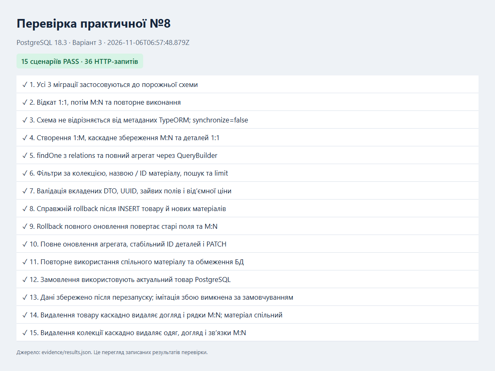
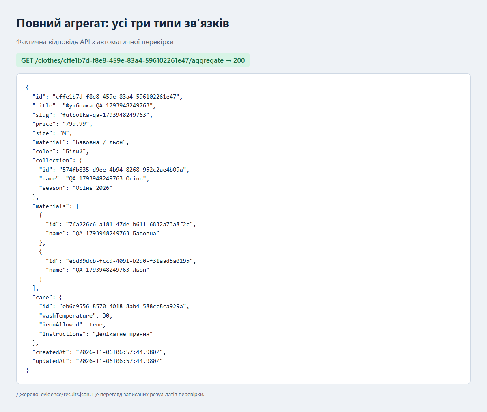
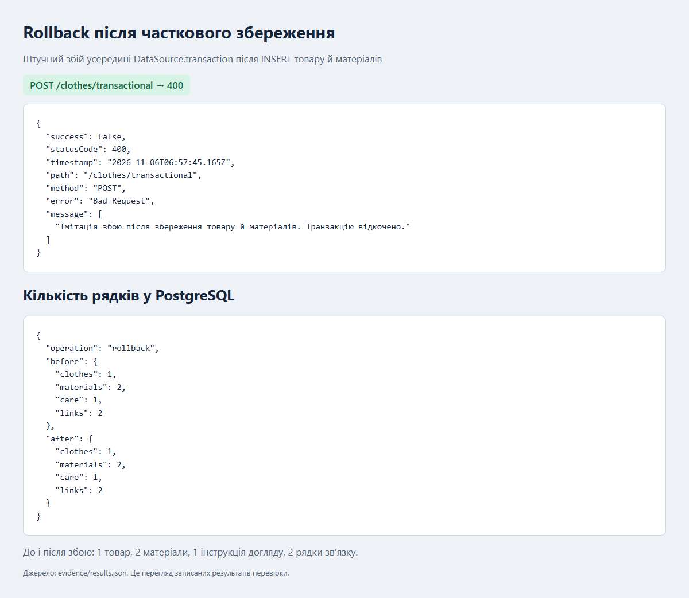

# Практична робота №8 — зв’язки, міграції та транзакції

**№23 у журналі → варіант 3: одяг. Виконано всі три рівні.**

Мета: перенести модель інтернет-магазину на керовану міграціями схему PostgreSQL, реалізувати три типи реляційних зв’язків, вибірки QueryBuilder і атомарне збереження агрегата.

## Основа

Окремий проєкт на основі вашого `C:\Users\vadim\Desktop\lab6WEB`. Використано встановлені залежності PostgreSQL/TypeORM із попереднього lab7WEB. Збережено Request Pipeline практичної №6: TrimPipe перед ValidationPipe, заборону зайвих полів, логування HTTP, фільтр помилок і X-Response-Time, а також shared-провайдери й інтеграцію замовлень. Початковий lab6WEB не змінено.

Каталог одягу зберігається в PostgreSQL; демонстраційні товари створюються явно командою seed. Замовлення, як у lab6WEB, зберігаються в пам’яті; практична №8 стосується агрегата одягу.

## Запуск

Потрібні Node.js **22 LTS**, npm і PostgreSQL **16+**. Приклад нижче використовує Docker Compose. Docker на машині перевірки відсутній: Compose-файл підготовлено, але запуск контейнера не перевірявся. Фактичні тести виконані на локальному PostgreSQL 18.3.

```powershell
cd C:\Users\vadim\Documents\Codex\2026-11-06\c-users-vadim-desktop-lab6web-2\outputs\lab8WEB
npm ci
Copy-Item .env.example .env
docker compose up -d --wait
npm run build
npm run migration:run
npm run migration:show
npm start
```

Після розпакування архіву замініть шлях у `cd` на вашу папку lab8WEB. Якщо `npm` посилається на відсутній npm-cli.js у Roaming, використовуйте `& 'C:\Program Files\nodejs\npm.cmd'` замість `npm`.

Для вже встановленого PostgreSQL пропустіть Docker, створіть окрему базу `lab8_store`, задайте її облікові дані в `.env`. Рекомендований locale для українського ILIKE: ICU `uk-UA`, наприклад `CREATE DATABASE lab8_store LOCALE_PROVIDER icu ICU_LOCALE 'uk-UA' TEMPLATE template0;` (виконується адміністратором).

Сервер: http://localhost:3000. У другому терміналі з папки проєкту:

```powershell
npm run seed
```

Seed друкує UUID колекції, товару й матеріалу та не дублює демонстраційні записи при повторному запуску. Для нестандартного порту задайте `$env:API_URL='http://localhost:3001'`. Завершення сервера: Ctrl+C.

## Схема даних

| Зв’язок | Реалізація | Поведінка |
|---|---|---|
| CollectionEntity 1 → M ClothingEntity | `@OneToMany`, `@ManyToOne`, FK `collection_id` | Видалення колекції каскадно видаляє її товари |
| ClothingEntity M ↔ N MaterialEntity | `@ManyToMany`, `@JoinTable`, `clothing_materials` | Каскад insert/update; наявний матеріал повторно використовується за унікальною назвою |
| ClothingEntity 1 ↔ 1 CareInstructionEntity | `@OneToOne`, `@JoinColumn`, UNIQUE FK `clothing_id` | Видалення товару каскадно видаляє інструкцію догляду |

Спільні матеріали не видаляються разом із товаром. Спроба видалити матеріал, який ще використовується, повертає 409 через FK. На рівні БД задано UUID, enum розміру, decimal(10,2), обмеження довжин, позитивну ціну, температуру 0–95, унікальні назви довідників і унікальність 1:1. Ціна в JSON відповіді є рядком, що зберігає точність PostgreSQL numeric.

Поле `material` з попередньої роботи збережено як текстовий опис; `materials` є окремим нормалізованим M:N довідником. Джерелом зв’язків і фільтрації є `materials`.

## Міграції — рівні 1 і 2

`synchronize: false` є спільним для Nest TypeOrmModule та CLI. Файл `src/database/data-source.ts` завантажує `.env`; CLI працює зі скомпільованими сутностями та міграціями з `dist`.

TypeORM CLI згенерував і застосував послідовно:

1. `CreateCollectionsAndClothes` — колекції, одяг, FK 1:M.
2. `AddMaterials` — матеріали, таблиця M:N, індекси й зовнішні ключі.
3. `AddCareInstructions` — догляд, унікальний FK 1:1, CASCADE.

Кожна міграція містить `up()` і `down()`. Для створення наступної після зміни сутностей:

```powershell
npm run build
npm run migration:generate -- src/database/migrations/NextChange
npm run build
npm run migration:run
```

Друга збірка потрібна, щоб щойно створений `.ts` файл міграції потрапив у `dist`. На незміненій схемі команда генерації повідомить, що змін немає; це очікувано.

Перевірка відкату на навчальній базі:

```powershell
npm run migration:revert
npm run migration:show
npm run migration:run
```

`revert` скасовує одну останню міграцію. Відкат із видаленням таблиць також видаляє їх дані, тому його демонструють на окремій тестовій базі. У перевірці послідовно відкочено 1:1 і M:N, SQL-запитами підтверджено відсутність відповідних таблиць, після чого виконано обидві міграції повторно. Повний журнал: [migrations.log](evidence/migrations.log).

## API та QueryBuilder

| Метод і маршрут | Результат |
|---|---|
| POST /collections | Створити сезонну колекцію |
| GET /collections | Список колекцій |
| DELETE /collections/:id | Видалити колекцію каскадно |
| GET /materials | Матеріали та UUID |
| DELETE /materials/:id | Видалити невикористовуваний матеріал |
| POST /clothes або /clothes/transactional | Створити повний агрегат у транзакції |
| GET /clothes/:id | `repository.findOne` із `relations` |
| GET /clothes/:id/aggregate | QueryBuilder: колекція, матеріали, догляд |
| GET /clothes | Фільтрація та пошук через QueryBuilder |
| PUT /clothes/:id | Повне транзакційне оновлення агрегата |
| PATCH /clothes/:id | Оновити базові поля товару |
| DELETE /clothes/:id | Видалити товар, його догляд і рядки M:N |
| POST /orders | Замовлення з фактичним товаром PostgreSQL |

Фільтри `collectionId`, `collection`, `materialId`, `material`, `search`, `limit` можна комбінувати. Назви колекції/матеріалу порівнюються точно; пошук назви товару — ILIKE. Приклад: `/clothes?collection=Осінь%202026&material=Бавовна&limit=10`.

Фільтр M:N використовує `innerJoinAndSelect` з параметрами, окремо від завантаження повного списку матеріалів. Тому після пошуку за бавовною товар також поверне льон, якщо він входить до складу. Користувацькі значення не підставляються в SQL рядковою конкатенацією. `limit` — від 1 до 100, за замовчуванням 100.

Повний приклад тіла POST і послідовність демонстрації містяться в [requests.http](requests.http). У VS Code REST Client іменовані відповіді автоматично підставляють створені UUID.

## Транзакції та rollback — рівень 3

У `ClothesService.saveAggregate()` усі читання і записи виконуються через переданий менеджер `DataSource.transaction`. Успіх фіксує товар, нові матеріали, M:N зв’язки та інструкцію догляду разом. PUT зберігає UUID товару й наявного догляду, замінює список матеріалів; старі спільні матеріали залишаються у довіднику.

Для демонстрації штучного збою перед запуском сервера:

```powershell
$env:LAB_ALLOW_FAILURE_DEMO='true'
npm start
```

Надішліть валідний POST із `simulateFailure: true` за прикладом `requests.http`. Помилка виникає **всередині транзакції після збереження товару та матеріалів**, повертається 400. Від’ємна ціна відхиляється ValidationPipe до транзакції, тому вона не є доказом rollback.

Фактичний результат SQL-перевірки: до і після невдалого створення — **1 товар, 2 матеріали, 1 догляд, 2 M:N зв’язки**. Невдалий PUT також повернув старі поля та старі зв’язки. Snapshot збережено в `observations` файла [results.json](evidence/results.json); SQL START TRANSACTION / INSERT / ROLLBACK — у [server.log](evidence/server.log).

Після демонстрації приберіть змінну: `Remove-Item Env:LAB_ALLOW_FAILURE_DEMO`. Без неї запит зі штучним збоєм повертає 403. Система конфліктів унікальності повертає 409: за одночасного створення однакового нового матеріалу один із запитів може бути відхилений, його транзакція повністю відкочується.

## Фактична перевірка

06.11.2026: Node.js 22.23.3, PostgreSQL 18.3, окрема база `lab8_verification`, ICU `uk-UA`, порт БД 55433. **Збірка успішна; 15 сценаріїв і 36 HTTP-запитів пройшли.**

Перевірено початкові міграції, відкат двох міграцій і повторний запуск, відсутність розбіжностей між схемою й TypeORM, всі три зв’язки, вкладену валідацію, фільтрацію й параметризацію, rollback створення та оновлення, повне оновлення, спільні матеріали, UNIQUE/FK, замовлення, перезапуск сервера та каскадне видалення. Дані каталогу після перезапуску збереглися. Тестовий HTTP-сервер після тестів зупиняється.

Знімки нижче — перегляд записаних фактичних результатів, створений із `evidence/results.json`.







Для повторної перевірки створіть **окрему порожню** базу з назвою, що закінчується на `_test` або `_verification`. Тест відкочує всі її міграції та видаляє навчальні таблиці разом із даними. Не використовуйте робочу базу.

```powershell
# Після створення бази lab8_verification адміністратором PostgreSQL:
$env:DB_HOST='127.0.0.1'
$env:DB_PORT='5432'
$env:DB_USER='nest_user'
$env:DB_PASSWORD='nest_password'
$env:TEST_DB_NAME='lab8_verification'
npm test
```

Тести самі запускають і зупиняють сервер на 3109, застосовують міграції та оновлюють `results.json`, `server.log`, `migrations.log`. Знімки можна оновити `node scripts/capture-evidence.js` за наявності Google Chrome (або вкажіть шлях у скрипті).

## Структура

```text
src/database/data-source.ts       спільна конфігурація CLI та Nest
src/database/migrations/          три згенеровані міграції
src/clothes/entities/             чотири сутності та їх зв’язки
src/clothes/dto/                  валідація тіла та query
src/clothes/clothes.service.ts    QueryBuilder і транзакції
src/clothes/catalog.controller.ts довідники
src/common/                      конвеєр запитів та фільтри помилок
src/orders/                      інтеграція замовлень із каталогом
scripts/seed.js                   повторюване створення прикладу
scripts/capture-evidence.js       знімки записаних результатів
requests.http                    ручна демонстрація API
test/api.test.js                 перевірка на реальному PostgreSQL
evidence/                        відповіді, SQL-журнали, знімки
```

## Відповіді для захисту

1. **1:M / M:1** — один запис колекції має багато товарів, FK зберігається в товарі; **M:N** — обидва боки можуть мати багато зв’язків через проміжну таблицю; **1:1** — FK має UNIQUE.
2. **JoinColumn** визначає власника FK та його стовпець. У 1:1 він стоїть на стороні `CareInstructionEntity`.
3. **JoinTable** задає таблицю M:N із двома зовнішніми ключами `clothing_id`, `material_id`; пара є первинним ключем.
4. **cascade** дозволяє ORM зберігати пов’язані сутності разом із батьківською. Надмірний cascade може ненавмисно змінювати чи видаляти спільні записи; тут дозволено лише insert/update матеріалів.
5. **CASCADE** видаляє залежні рядки, **SET NULL** залишає їх і очищає FK; для SET NULL стовпець має дозволяти NULL.
6. **synchronize** змінює схему автоматично та може втратити дані. Міграції дають контрольовані, версіоновані up/down, які можна перевірити до застосування.
7. **migration:revert** знаходить останню виконану міграцію, виконує її down і прибирає запис із таблиці migrations.
8. **QueryBuilder** доцільний для кількох JOIN, динамічних умов, агрегацій, параметризованих фільтрів та спеціальних вибірок.
9. **ACID:** атомарність, узгодженість, ізоляція, довговічність. DataSource.transaction виконує callback на одному менеджері в транзакції: успішне завершення дає commit, виняток — rollback. Конкретні правила ізоляції визначає PostgreSQL і вибраний рівень ізоляції.

## Публікація

Проєкт підготовлено для Git. Репозиторій GitHub для практичної №8 не задано, тому вихідний код не опубліковано. Для здачі завантажте в окремий репозиторій вихідні файли разом із README та evidence, виключивши `.env`, `node_modules` і `dist`.
